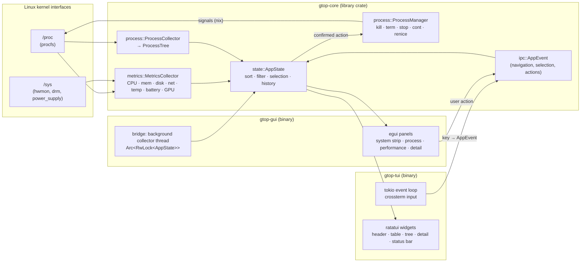

<p align="center">
  
</p>

<h1 align="center">gtop</h1>

<p align="center">
  <b>A real-time Linux process manager with a terminal UI and a desktop GUI, built in Rust on one shared core crate.</b>
</p>

<p align="center">
  
  
  
  
  
  
</p>

```
╔══ GTOP ══╗  v0.1.0  CPU ████░░░░  24%   RAM ███░░░░░  38%   Load 1.2 0.9 0.8
```

## Overview

gtop is a process manager in the spirit of `top`/`htop`, written in Rust (July 2026). It has two front ends:

- **`gtop-tui`**, a keyboard-driven terminal UI built with ratatui and crossterm.
- **`gtop-gui`**, a desktop app built with egui/eframe, with *Processes* and *Performance* tabs.

Both are thin presentation layers over **`gtop-core`**. That library crate reads `/proc` and `/sys`, builds the process tree, handles sorting, filtering and selection state, and sends signals. Because the logic lives in one place, the two UIs behave the same way and can't drift apart.

## Key features

- **System metrics** from procfs/sysfs: per-core CPU, load average, RAM and swap, disk and network throughput, temperatures, battery, and GPU (Intel and AMD via `/sys/class/drm`).
- **Process list and tree view**: parent/child hierarchy, kernel-thread toggle, and search by name or PID.
- **Sorting** by PID, user, CPU %, memory %, RSS, nice value, state, or name, in either direction.
- **Batch actions**: multi-select processes, then kill (SIGKILL), terminate (SIGTERM), pause (SIGSTOP), or resume (SIGCONT). Destructive actions ask for confirmation first. Renice is also supported through the core `ProcessManager`.
- **History sparklines**: CPU history shown as `▁▂▃▄▅▆▇█` sparklines, kept in bounded ring buffers.
- **TUI extras**: four themes, a layout that adapts to terminal size, monochrome (`--no-color`) and ASCII-only (`--ascii`) modes, and built-in shell completions and a man page.
- **Packaging**: an Arch Linux `PKGBUILD` (split into `gtop-tui` and `gtop-gui` packages), an AppImage build script, and `.desktop` entries.

## Architecture



Each refresh tick, both front ends ask the core collectors for a new snapshot and pass it to `AppState`. User input becomes an `AppEvent` that only changes state. Signals are sent only after an action has been confirmed.

## Tech stack

| Area | Crates |
|------|--------|
| Language | Rust (edition 2021), Cargo workspace |
| System data | `procfs`, `nix` (signals, users, resources), `libc` |
| Async runtime | `tokio`, `futures-util` |
| Terminal UI | `ratatui`, `crossterm` |
| Desktop GUI | `egui`, `eframe`, `egui_plot` |
| CLI | `clap` (derive) |
| Misc | `ringbuffer`, `fuzzy-matcher`, `serde` + `toml`, `directories`, `chrono`, `thiserror`/`anyhow`, `tracing` |

## Getting started

### Requirements

- Linux (procfs-based, so other operating systems aren't supported).
- A recent stable Rust toolchain from [rustup](https://rustup.rs). The workspace declares `rust-version = 1.80`.
- For `gtop-gui`: the usual eframe runtime libraries for X11 or Wayland (for example `libxkbcommon`, `libGL`/Mesa). Most desktop systems already have them.

### Build from source

```bash
git clone https://github.com/GabrielHuertasdl/gtop.git
cd gtop
cargo build --release
```

The binaries are written to `target/release/`:

| Binary | Crate | Description |
|--------|-------|-------------|
| `gtop-tui` (also `gtop`) | `gtop-tui` | Terminal UI |
| `gtop-gui` | `gtop-gui` | Desktop GUI |

Run either one straight from Cargo:

```bash
cargo run --release -p gtop-tui
cargo run --release -p gtop-gui
```

### Arch Linux package

`packaging/aur/PKGBUILD` builds the split packages `gtop-tui` and `gtop-gui`, and installs the desktop files, icon, shell completions and man page:

```bash
cd packaging/aur
makepkg -si
```

### AppImage (GUI)

```bash
cargo build --release
packaging/appimage/build-appimage.sh   # needs appimagetool in PATH
```

## Usage

```
gtop-tui [OPTIONS]

  -i, --interval <MILLIS>    Refresh interval (default: 1000)
  -t, --tree                 Start in tree view
  -k, --kernel               Show kernel threads on startup
      --theme <NAME>         default | catppuccin-mocha | gruvbox | nord
      --no-color             Monochrome output
      --ascii                ASCII-only characters
      --completions <SHELL>  Print shell completions (bash/zsh/fish) and exit
      --man                  Print man page and exit
```

```
gtop-gui [OPTIONS]

      --width <PX>           Initial window width  (default: 1200)
      --height <PX>          Initial window height (default: 800)
```

> **Note:** in v0.1.0, both front ends refresh at a fixed 1000 ms tick. `--interval` is parsed but not yet applied.

### TUI keybindings

| Key | Action |
|-----|--------|
| `j` / `↓`, `k` / `↑` | Move cursor |
| `Ctrl-D` / `PgDn`, `Ctrl-U` / `PgUp` | Page down / up |
| `g` / `Home`, `G` / `End` | Jump to top / bottom |
| `Space` | Toggle selection |
| `a` / `A` | Select all / deselect all |
| `Enter` / `d` | Toggle detail panel |
| `X` | Kill selected (SIGKILL) |
| `t` | Terminate selected (SIGTERM) |
| `p` / `r` | Pause / resume (SIGSTOP / SIGCONT) |
| `/` | Search by name or PID |
| `T` | Toggle tree / list view |
| `i` | Toggle kernel threads |
| `I` | Toggle sort direction |
| `1`–`8` | Sort by PID / USER / CPU / MEM / RSS / NI / S / NAME |
| `F5` | Force refresh |
| `q` / `Ctrl-C` | Quit |

### Themes

`default` (dark, teal accent `#00d4aa`), `catppuccin-mocha`, `gruvbox`, `nord`:

```bash
gtop-tui --theme catppuccin-mocha
```

### Shell completions

```bash
gtop-tui --completions bash >> ~/.bash_completion
gtop-tui --completions zsh  >  ~/.zfunc/_gtop-tui
gtop-tui --completions fish >  ~/.config/fish/completions/gtop-tui.fish
```

## Testing

```bash
cargo test --workspace
```

So far, the test suite only has unit tests for the formatting helpers in `gtop-core`.

## Project structure

```
gtop/
├── Cargo.toml              # workspace manifest and shared dependency versions
├── crates/
│   ├── gtop-core/          # library: metrics/, process/, state/, ipc/, config, util
│   ├── gtop-tui/           # ratatui binary: app loop, adaptive layout, widgets/
│   └── gtop-gui/           # egui binary: app, bridge (collector thread), panels/
├── packaging/
│   ├── aur/                # PKGBUILD and .desktop files
│   ├── appimage/           # AppImage build script and AppRun
│   └── linux/              # generic .desktop entry
└── assets/icons/gtop.svg
```

## License

[MIT](LICENSE) © 2026 Gabriel Huertas
